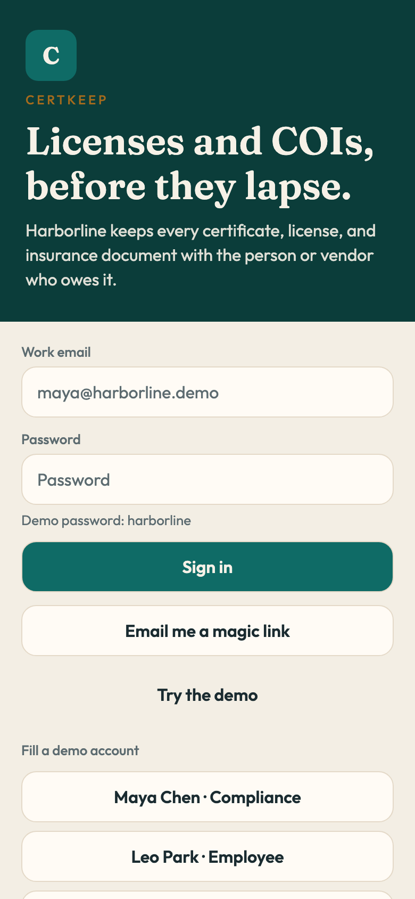
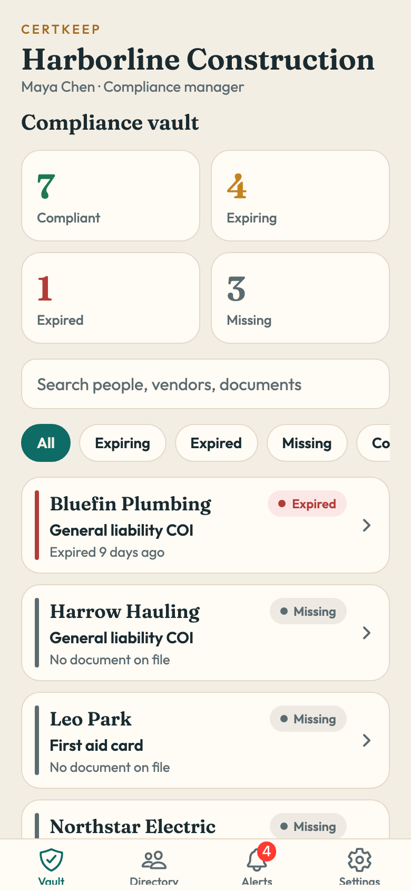
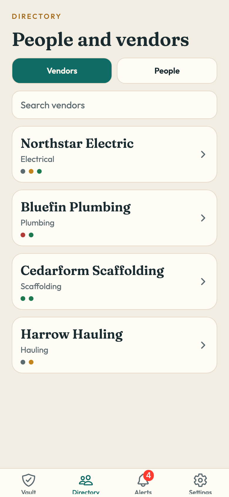
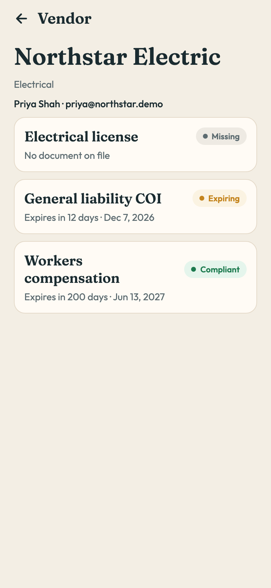
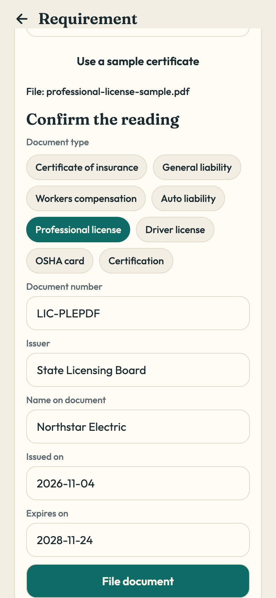
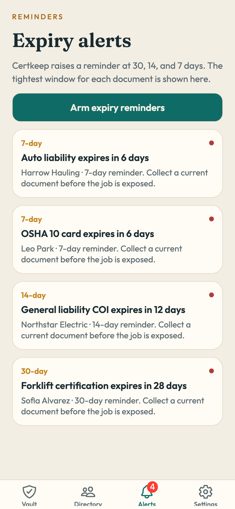
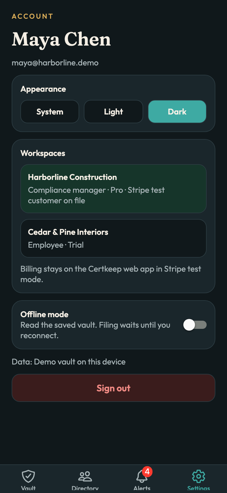

# Certkeep

Certkeep is the mobile vault for licenses, certifications, and certificates of insurance. A compliance manager sees who is current, who is about to lapse, and who has nothing on file. An employee or vendor photographs or uploads the document, confirms the fields Certkeep reads, and files it to the requirement.

This app is the mobile companion to the Certkeep web workspace. Both talk to the same tenant-scoped Supabase project. With no keys configured, the app opens a seeded Harborline Construction demo.

Live preview target: [certkeep-app.quvantic.com](https://certkeep-app.quvantic.com)

## Features

- Sign in with email and password, or a magic link. **Try the demo** opens Maya Chen’s compliance desk with no account setup.
- Workspace switcher. Maya is a compliance manager at Harborline Construction and an employee at Cedar & Pine Interiors. The tabs follow the role.
- Compliance vault with compliant, expiring (30 days), expired, and missing counts, search, and filters.
- Directory of people and vendors, then a requirement with its filing history.
- Camera, photo library, and PDF picker. A sample certificate drives the same confirm-and-file path in the demo.
- Mocked document reading for type, number, issuer, holder, and expiry. Nothing is filed until those fields are confirmed.
- Managers can approve a filing or ask for a replacement.
- Expiry reminders at 30, 14, and 7 days, with an inbox and on-device scheduling through `expo-notifications`. The web preview shows the same reminders locally.
- Light, dark, and system appearance. Offline mode serves the last vault saved on the device and blocks new filings until the connection returns.
- Deep links on `certkeep://` and `https://certkeep-app.quvantic.com` for people, vendors, requirements, and magic-link return.

## Screenshots

Sign in and the Harborline demo.





Directory, a vendor, and the confirm step before a document is filed.







Alerts, and settings in dark mode with both workspaces.





## Architecture

Expo SDK 58, Expo Router, React Native, and TypeScript in strict mode. Routes live in `src/app`. Shared UI, theme, and session state live beside them.

```
src/app            screens and role-aware tabs
src/domain         status, alert windows, extraction, role rules
src/data           repository interface, mock vault, Supabase client, offline cache
src/notifications  local expiry reminders
supabase/schema.sql  shared Postgres schema and RLS
```

The repository interface is the only door to data. `createAppRepository` picks the implementation:

- **Mock**, when `EXPO_PUBLIC_SUPABASE_URL` or `EXPO_PUBLIC_SUPABASE_ANON_KEY` is missing. Seeded users, requirements, and documents live in memory and AsyncStorage.
- **Supabase**, when both public env vars are set. The client uses the anon key and the signed-in JWT. Queries are scoped by `organization_id`. Row Level Security is the real boundary. There is no service-role key in the app.

`supabase/schema.sql` is the shared contract with the web app: organizations, members, roles, people, vendors, requirements, documents, alerts, a `documents` storage bucket, and `refresh_requirement_alerts`. Billing stays on the web app in Stripe test mode. The mobile app only shows the plan that Postgres already stores.

Offline reads go through a cache in front of either implementation. Writes fail with a clear message while offline mode is on.

## Mock and real mode

| | Mock | Supabase |
| --- | --- | --- |
| Env | none | `EXPO_PUBLIC_SUPABASE_URL`, `EXPO_PUBLIC_SUPABASE_ANON_KEY` |
| Sign in | demo password `harborline`, or the magic-link preview on device | Supabase Auth email and magic link |
| Data | Harborline Construction and Cedar & Pine Interiors | The signed-in memberships only |
| Push | Local notifications on device; in-app notices on web | Same client wiring. Delivery to a locked phone needs APNs and FCM credentials in Expo |

Demo accounts:

| Person | Email | Role |
| --- | --- | --- |
| Maya Chen | maya@harborline.demo | Compliance manager at Harborline, employee at Cedar & Pine |
| Leo Park | leo@harborline.demo | Employee |
| Priya Shah | priya@northstar.demo | Vendor, Northstar Electric |
| Andre Walsh | andre@harborline.demo | Owner |
| Helen Cho | helen@cedar.demo | Compliance manager at Cedar & Pine |

Password for every demo account: `harborline`.

Copy `.env.example` to `.env` only when you have a real project. Leave the file empty to stay on the demo.

## Run it

Install and start:

```bash
npm install
npx expo start
```

- **Expo Go:** scan the QR code from `npx expo start`. Camera, photo library, and notification permissions are requested when you use those actions.
- **Web:** `npm run web` serves the dev bundle at http://127.0.0.1:43123
- **Static preview:** `npm run export:web` then `npx serve dist -l 4173 --single`

### EAS

`eas.json` has development, preview, and production profiles. Identifiers are `com.quvantic.certkeep` on iOS and Android. This repo does not run a paid build. When you want one:

```bash
npx eas-cli@latest build --profile preview --platform android
```

Set `EAS_PROJECT_ID` in the Expo project before a cloud build. No store submit is configured with secrets.

## Tests

```bash
npm test          # Jest and React Native Testing Library
npm run lint
npm run typecheck
npm run export:web
npm run test:e2e  # Playwright against the web export
```

Maestro flows for a simulator or device are in `.maestro/`:

- `manager-vault.yaml` — demo desk, missing COI, directory, alerts
- `employee-vault.yaml` — Leo only sees his own cards
- `vendor-upload.yaml` — Priya files the electrical license

```bash
maestro test .maestro/manager-vault.yaml
```

GitHub Actions (`.github/workflows/ci.yml`) runs lint, typecheck, unit tests, the web export, and Playwright on `ubuntu-latest`. It needs no secrets.

Regenerate the README images from a running web preview:

```bash
npx serve dist -l 4173 --single
SCREENSHOT_URL=http://127.0.0.1:4173 node scripts/capture-screenshots.mjs
```

## Still needs a person

- An Apple Developer account and a Google Play Console account before TestFlight or store listing. The bundle id is reserved only in this repo until those enrollments exist.
- A Supabase project with `supabase/schema.sql` applied, Auth email enabled, and the anon key placed in `EXPO_PUBLIC_SUPABASE_URL` and `EXPO_PUBLIC_SUPABASE_ANON_KEY`. Do not put the service-role key in the app.
- DNS for `certkeep-app.quvantic.com` pointing at the hosted web export, plus the Apple associated-domain file and Android asset links if universal links should open the native app.
- Expo push credentials (APNs key, FCM v1) before locked-phone delivery. Local scheduling works without them.
- An Expo project id if you want EAS Build. Stripe customer portal stays on the web app.
